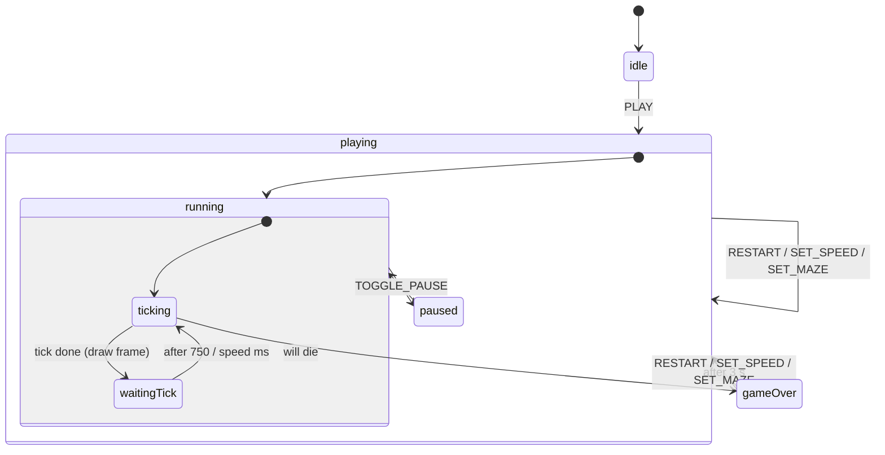

# Snake II - Technical Documentation

Snake II is a remake of the classic Nokia game, written in TypeScript. All game
logic lives in [XState](https://xstate.js.org/docs/) state machines, the screen
is drawn on an HTML5 canvas, and the same code runs in a browser, on phones, and
as a native Windows application (Electron).

- [1. Playing the game](#1-playing-the-game)
- [2. Getting started](#2-getting-started)
- [3. Windows desktop app](#3-windows-desktop-app)
- [4. Architecture](#4-architecture)
- [5. The state machines](#5-the-state-machines)
- [6. Mazes](#6-mazes)
- [7. Speed and settings](#7-speed-and-settings)
- [8. Input: keyboard, touch and swipe](#8-input-keyboard-touch-and-swipe)
- [9. Rendering](#9-rendering)
- [10. Typing](#10-typing)
- [11. Testing](#11-testing)
- [12. Extending the game](#12-extending-the-game)

---

## 1. Playing the game

Steer the snake to the food. Every piece of food makes the snake one segment
longer and scores points equal to the current **speed level**. Every 300 points the
snake speeds up by one level (up to level 25). Every few foods a
**bonus** appears in the top-right corner with a countdown: eat it before it
disappears for extra points (more points at a higher speed, fewer the longer you
wait).

The snake dies if it hits **its own body** or a **wall of the current maze**.
The edges of the screen are not walls: the snake leaves on one side and comes
back on the opposite side.

The game is forgiving once: when the snake is about to crash it stops for one
tick in front of the obstacle, and you can still turn away. If you do nothing
(or turn into the obstacle) the game is over; the snake blinks, and a new game
starts automatically after three seconds.

### Controls

| Action              | Keyboard              | Touch                          |
| ------------------- | --------------------- | ------------------------------ |
| Steer               | Arrow keys or `WASD`  | On-screen D-pad, or swipe      |
| Pause / resume      | `P`, `Space`, `Esc`   | **Pause** button               |
| Speed down / up     | `-` / `+`             | **-** / **+** next to *Speed*  |
| Previous / next maze| `M` (next)            | **‹** / **›** next to *Maze*   |
| New game            | `R`                   | **New game** button            |

Changing the speed or the maze starts a new game, because the score depends on
both. Your choice is remembered the next time you open the game.

---

## 2. Getting started

You need [Node.js](https://nodejs.org/) 18 or newer.

```bash
npm install        # install dependencies
npm run dev        # development server on http://localhost:3000
npm run build      # production build into dist/
npm run serve      # preview the production build
npm run typecheck  # TypeScript check, no output files
npm test           # run the unit tests once
npm run test:watch # run the unit tests on every change
```

Yarn works too; replace `npm run` with `yarn`.

> `vite.config.mts` uses the `.mts` extension because `vite-tsconfig-paths` is an
> ES module and `package.json` does not set `"type": "module"`.

---

## 3. Windows desktop app

The desktop app is the web game running inside [Electron](https://www.electronjs.org/).
There is no extra game code: Electron simply opens the production build
(`dist/index.html`) in a window.

| File                  | Purpose                                                         |
| --------------------- | --------------------------------------------------------------- |
| `electron/main.js`    | Creates the window, `F11` toggles full screen, single instance. |
| `build/icon.ico`      | Application icon (16 to 256 px). `build/icon.png` is the source.|
| `package.json`        | `build` section: electron-builder configuration.                |

### Run it as a desktop app (no installer)

```bash
npm install
npm run desktop       # builds the game, then opens it in an Electron window
```

For live reload while developing, start `npm run dev` in one terminal and
`npm run desktop:dev` in another; the window then loads the dev server.

### Build the Windows installer

Run on Windows:

```bash
npm run dist:win
```

The results are written to `release/`:

- `Snake II-Setup-1.0.2.exe` - installer (lets you choose the folder, creates
  Desktop and Start Menu shortcuts, installs per user, no admin rights needed).
- `Snake II-Portable-1.0.2.exe` - a single file you can run without installing.

The first run downloads Electron (about 100 MB), so it needs an internet
connection.

**Notes**

- The executables are **not code-signed**. Windows SmartScreen may show
  "Windows protected your PC": choose *More info*, then *Run anyway*. Removing
  the warning requires a code-signing certificate; see electron-builder's
  [code signing guide](https://www.electron.build/code-signing).
- To change the name, version or app id, edit `name`/`productName`/`version`
  and `build.appId` in `package.json`. The details shown in the Windows file
  properties come from `package.json` too: `description` (file description),
  `author.name` (company: The Native Black), `version` (file version: 1.0.2)
  and `build.copyright`.
- The Electron window uses `contextIsolation`, `sandbox` and no Node.js
  integration in the page, so the game runs with the same restrictions as a
  normal web page.

---

## 4. Architecture

```
index.html            page: canvas, settings panel, on-screen D-pad
electron/main.js      Windows desktop wrapper
src/
  main.ts             entry point: starts the game and connects input/UI
  constants.ts        grid size, speeds, timings, colours
  types.ts            all shared TypeScript types
  settings.ts         speed/maze validation, saving to localStorage
  mazes.ts            maze layouts and wall lookup
  drawingMaps.ts      pixel-art sprites (ASCII)
  renderer.ts         draws a frame on the canvas
  input.ts            keyboard, D-pad and swipe -> game events
  ui.ts               settings panel and status text
  game/
    game.machine.ts   the game state machine
    game.actions.ts   what the game machine does (assign, send, draw)
    game.guards.ts    conditions (will the snake crash? eat food? ...)
    game.selectors.ts pure helpers: next position, free cells for items
    game.scoring.ts   score formulas
  snake/              snake machine and actions (owns the body)
  food/               food machine (owns the food position)
  bonus/              bonus machine (owns the bonus position and sprite)
```

Data flows in one direction:

```
 keyboard / D-pad / swipe / buttons
              |  events (KEY_PRESS, SET_MAZE, ...)
              v
        game machine  ---- messages ---->  snake machine
              |  (guards decide, actions assign)
              v
        renderer.ts  ->  <canvas>          ui.ts -> settings panel
```

Imports use the `src/...` path alias (`tsconfig.json` `baseUrl`, resolved by
`vite-tsconfig-paths`).

---

## 5. The state machines

### Game machine (`game/game.machine.ts`)



`RESTART`, `SET_SPEED` and `SET_MAZE` are handled at the root of the machine, so
they work in every state. `SET_SPEED` and `SET_MAZE` only restart when the value
really changes (guards `speedWillChange` / `mazeWillChange`).

Entering `playing` runs `resetGameData`, `spawnSnake` and `spawnFood`.

#### One tick

`ticking` is a nested machine that finishes within a single step (every
transition is an `always` transition), so a tick is atomic:

```
checkingThatWillDie
   willDie    -> gameOver
   willCrash  -> crashing            (tell the snake to stop; one tick of grace)
   otherwise  -> checkingBonus
checkingBonus
   willEatBonus                       -> score the bonus, remove it, move
   bonus timer ran out                -> remove the bonus
   bonus on screen                    -> count its timer down
checkingFood
   willEatFood -> afterEatFood        (score, spawn new food, snake grows)
afterEatFood
   time for a bonus -> spawnBonus
   no bonus on screen -> count down to the next bonus
updatingSnakePosition                (send UPDATE_POSITION to the snake)
```

When `ticking` is done the machine removes the oldest queued key press, draws
the frame and waits for the tick delay: `750 ms / (speed + speedBoost)`.

#### Context

| Field                    | Meaning                                                   |
| ------------------------ | --------------------------------------------------------- |
| `speed`, `maze`          | The settings (see `GameSettings`).                        |
| `snake`, `food`, `bonus` | Spawned child machines (actors); `null` when absent.      |
| `keystrokes`             | Queue of turns not yet applied (at most 3).               |
| `speedBoost`             | Speed levels earned by scoring (1 per 300 points); resets each game. |
| `countdownToBonus`       | Foods still needed before a bonus appears.                |
| `countdownToRemoveBonus` | Ticks left before the bonus on screen disappears.         |
| `score`                  | Current score.                                            |

#### Key presses

`KEY_PRESS` is only accepted while running (not paused), and by `isValidKey`
only if it is a 90 degree turn compared to the last queued direction (or the
snake's current direction). So pressing the opposite direction or the same
direction does nothing, and quick combinations such as *up, left* inside one tick
are applied in order, one per tick.

### Snake machine (`snake/snake.machine.ts`)

| State        | Next `UPDATE_POSITION` ...                                     |
| ------------ | -------------------------------------------------------------- |
| `idle`       | adds a new head and removes the tail (plain movement).         |
| `eatingFood` | adds a new head and keeps the tail (the snake grows).          |
| `eatingBonus`| adds a head, marks it as carrying food, removes the tail.      |
| `crashing`   | does nothing until the game sends a real position again.       |

### Food and bonus machines

They have no behaviour: they exist so the game can `spawn` them as actors and
read their position with `getSnapshot().context`. A bonus is **two cells wide**
(`x` and `x + 1`).

---

## 6. Mazes

A maze is a set of wall cells on the 24 x 14 board. Choose one with the
**Maze** control or the `M` key. They are defined in `src/mazes.ts` as ASCII
pictures:

| # | Name    | Description                                                    |
| - | ------- | -------------------------------------------------------------- |
| 0 | None    | Open board.                                                    |
| 1 | Frame   | Walls around the board with a gate in the middle of each side. |
| 2 | Pillars | Scattered 2 x 2 blocks.                                        |
| 3 | Bars    | Three long horizontal walls.                                   |
| 4 | Crosses | Four plus-shaped walls.                                        |
| 5 | Corners | An L-shaped wall in each corner.                               |
| 6 | Zigzag  | Four vertical walls alternating from the top and the bottom.   |
| 7 | Labyrinth | Sealed by a solid border (no gates), with lanes of inner walls. The snake cannot wrap around the screen. |

How walls work:

- `willHitWall` (in `game.guards.ts`) checks whether the next cell is a wall.
  `willCrash` is "hits itself **or** a wall", so walls get the same one-tick
  grace as the snake's own body.
- Food and bonuses are only placed on free cells: not on walls, not on the
  snake, and a bonus needs two free cells side by side
  (`game.selectors.ts`).
- The renderer draws every wall cell as a solid 4 x 4 block.

### Adding a maze

Add an entry to `LAYOUTS` in `src/mazes.ts`:

```ts
[
  'My maze',
  [
    '........................', // 14 rows, 24 columns each
    '..####..............####',
    // ...
  ],
],
```

`#` is a wall and `.` is free space. A mistake in the size throws an error when
the game loads. `npm test` then checks every maze for the rules below, so you
find out immediately if a layout is unplayable:

1. The snake's row (row 5) is free from column 0 to column 15, so the game
   cannot end in the first seconds.
2. Every free cell can be reached from every other (including through the
   wrap-around edges), so food never appears in a sealed pocket.

The maze list in the UI updates automatically.

---

## 7. Speed and settings

- **Speed levels:** 1 (slowest) to 25 (fastest), default 8. One tick lasts
  `750 / speed` ms, so level 1 is about 750 ms per move and level 25 about 30 ms.
- **Speed-ups:** every time the score reaches another multiple of 300
  (`SCORE_PER_SPEED_UP`), the snake gains one speed level for the rest of that
  game (`speedBoost` in the game context, capped at level 25). It is not saved
  and resets on a new game. Food and bonus points use the boosted speed.
- **Scoring** (`game.scoring.ts`): food = the speed level; bonus =
  `5 * (speed + 9) - 2 * (ticks the bonus was on screen)`.
- **Persistence** (`settings.ts`): speed and maze are saved in `localStorage`
  under the key `snake-ii:settings` and restored at startup. Corrupt or
  out-of-range values fall back to valid ones; if storage is unavailable the game
  simply forgets the settings.
- `SET_SPEED` clamps its value to 1-25, so `+` at level 25 does nothing and the
  UI disables the button.

---

## 8. Input: keyboard, touch and swipe

All input ends up as events sent to the game machine (`src/input.ts`).

- **Keyboard:** `getEventForKey` maps a key to an event; `bindKeyboard`
  listens on `window`. Browser shortcuts with Ctrl/Alt/Meta are left alone, and
  holding `P` or `R` does not repeat.
- **On-screen D-pad:** the four buttons in `#touch-controls` send `KEY_PRESS`
  on `pointerdown`, so there is no 300 ms tap delay. CSS shows the D-pad on
  touch devices (`any-pointer: coarse`) and on screens narrower than 640 px, and
  hides it on desktop.
- **Swipe:** a swipe of at least 24 px on the game screen steers the snake in
  the dominant direction. The canvas uses `touch-action: none` so swiping does
  not scroll the page. Mouse input is ignored for swipes.
- The canvas is scaled with CSS (`width: 100%`), so the game fits any phone
  screen while the drawing stays crisp (`image-rendering: pixelated`).

---

## 9. Rendering

`renderer.ts` exports a `GameRenderer` class (one instance, created on the first
frame) and the `renderFrame(state)` function used by the game's `drawGame`
actions. A frame is drawn from scratch every time:

1. Background, score, bonus icon and countdown (header).
2. The frame around the playing field.
3. Maze walls.
4. Snake. The head opens its mouth when food or a bonus is in the next cell.
   Body parts pick a straight or turning sprite from their own direction and the
   direction of the part in front of them (`TURN_SPRITE_KEYS`), and "full"
   versions show food being digested.
5. Food and bonus.

Everything is made of **LCD dots**: sprites in `drawingMaps.ts` are arrays of
strings where any non-space character is a lit dot. One dot is
`SCALE_FACTOR` (6) canvas pixels, one board cell is `GRID_ITEM_SIZE` (4) dots.

---

## 10. Typing

TypeScript runs in `strict` mode and `npm run typecheck` passes with no errors.
All types live in `src/types.ts`:

- `Direction`, `Point`, `Sprite` - shared primitives.
- `SnakeEvent`, `GameEvent` - discriminated unions of every event the machines
  accept, so a typo such as `{ type: 'KEY_PRES' }` is a compile error.
- `GameSettings` (`speed`, `maze`) and `GameContext extends GameSettings`.
- `SnakeActor`, `FoodActor`, `BonusActor` - typed references to the spawned
  child machines, so `context.snake.getSnapshot().context.body` is fully typed.
- `RenderState` - exactly what the renderer needs to draw a frame.

Guards and actions are plain functions typed as `(context: GameContext, event:
GameEvent) => ...` and narrow the event inside (`event.type === 'KEY_PRESS'`).
`createGameMachine(settings)` builds a machine with the given starting settings,
and `GameService` / `GameState` in `ui.ts` are derived from it.

---

## 11. Testing

```bash
npm test
```

[Vitest](https://vitest.dev/) runs 51 tests in `src/**/*.test.ts`:

| File                      | What it checks                                            |
| ------------------------- | --------------------------------------------------------- |
| `mazes.test.ts`           | Size, free start row and connectivity of every maze.      |
| `game.selectors.test.ts`  | Wrap-around movement, items never spawn on walls/snake, scoring. |
| `game.machine.test.ts`    | The real game machine with fake timers: movement, speed, pause, wall crash and grace tick, game over and restart, settings changes, eating food. |
| `settings.test.ts`        | Clamping, saving, corrupt data.                           |
| `input.test.ts`           | Key mapping.                                              |

The machine tests replace the renderer with a mock (`vi.mock('src/renderer')`),
so no browser is needed.

---

## 12. Extending the game

- **New setting:** add the field to `GameSettings`, an event and a guard/action
  in the game machine, a control in `index.html` and `ui.ts`, and extend
  `settings.ts` to validate it.
- **New key:** add it to `getEventForKey` in `input.ts` (and its test).
- **New sprite:** add it to `drawingMaps.ts` as an array of strings.
- **Different board size:** change `GRID_COLUMNS` / `GRID_ROWS`; the renderer
  derives its layout from them, but every maze layout must then be resized (the
  game tells you which one at startup).

### Known limitations

- Filling the entire board has no win screen; with no free cell left, new food
  appears at the top-left cell.
- There is no high-score table.
- The Windows build is not code-signed.
